<h3 data-importer="text" align="center"> Hello there!👋 Welcome to my digital corner.
I'm Nisa, an active student majoring in Business Information Systems, frontend developer, AI enthusiast, UI/UX designer. Take a look at what I've been building! 🚀 </h3>

###

<!-- Figma -->
  
  

  <!-- Notion -->
  
  

  <!-- React.js -->
  
  

  <!-- SQLite -->
  
  
  
  <!-- JavaScript -->
  
  

  <!-- Tailwind CSS -->
  
  
  
  <!-- Bootstrap -->
  
  

  <!-- HTML5 -->
  
  

  <!-- CSS3 -->
  
  

  <!-- PostgreSQL / pgAdmin -->
  
  

  <!-- C++ -->
  
  

  <!-- PHP -->
  
  

  <!-- Laravel -->
  
  

  <!-- Supabase -->
  
  

  <!-- Python -->
  
  

  <!-- AWS -->
  
  

  <!-- VS Code -->
  
  

  <!-- Kiro -->
 
<!-- Power BI -->
  
  
 <!-- Laragon -->
  

  <!-- Google Antigravity -->
 
  

  <!-- Claude AI -->

 
 
 ###

 

  

###

  
  
  

###

<picture data-importer="pacman">
  <source media="(prefers-color-scheme: dark)" srcset="https://raw.githubusercontent.com/nisa-fitriani39/nisa-fitriani39/pacman-output/pacman-contribution-graph-dark.svg?game=pacman">
  <source media="(prefers-color-scheme: light)" srcset="https://raw.githubusercontent.com/nisa-fitriani39/nisa-fitriani39/pacman-output/pacman-contribution-graph.svg?game=pacman">
  
</picture>

###

  

###

